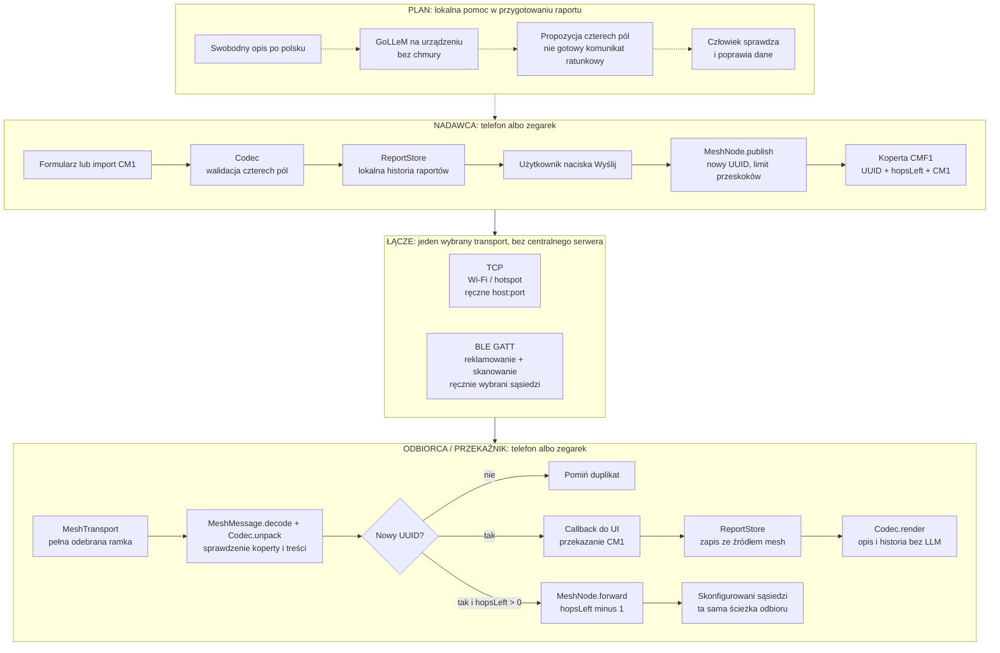

# Crisis Mesh — tablica architektury

Stan odniesienia: [implementacja BLE `3392278`](https://github.com/PiotrStyla/crisis_mesh/commit/3392278), 2026-10-19.
Ta sama aplikacja Kotlin/Compose działa na telefonie i zegarku; każde urządzenie
może być nadawcą, odbiorcą i przekaźnikiem. Komputer/ADB służyły do sterowania
podczas testów, **nie są wymaganym serwerem komunikacji**.

**Linie ciągłe: istniejąca ścieżka aplikacji. Linie przerywane: planowana
integracja lokalnego LLM, której nie ma jeszcze w aplikacji Android.**

[Wersja PNG do pobrania lub wysłania na Discord](docs/architecture.png).



## Jak czytać granice

- **LLM nie jest elementem transportu.** Ma proponować pola, nie interpretować
  odebranych pakietów, routować wiadomości ani samodzielnie alarmować.
- **Zapis i forwarding są rozdzielone.** Callback odbioru kolejkuje zapis w UI;
  przekaźnik nie czeka na potwierdzenie trwałego zapisu. Diagram nie oznacza,
  że dane są już na dysku w chwili przekazania dalej.
- **ACK łącza nie jest potwierdzeniem końcowego dostarczenia.** TCP odpowiada
  `0x06` po pełnej ramce; BLE odpowiada na kolejne zapisy ATT. To nie dowodzi
  poprawności faktów, zapisu w historii ani odbioru przez dalsze węzły.
- **Bezpieczeństwo jest osobnym brakującym elementem.** Poprawny CM1/UUID
  nie uwierzytelnia źródła. Brak szyfrowania i ochrony przed fałszywymi raportami.

## Dane przekazywane między warstwami

| Warstwa | Zawartość i granice |
|---|---|
| Raport lokalny | Cztery pola, lokalna notatka, źródło i czas urządzenia. Notatka nie jest wysyłana. |
| CM1 | `CM1\|people\|children\|hazard\|need`; stratny skrót, nie pełna treść zgłoszenia. Maks. 28 B dla tego schematu. |
| CMF1 | 4 B wersji + 16 B UUID + 1 B budżetu przekazań + CM1. Bez lokalizacji, czasu zgłoszenia, podpisu i szyfrowania. |
| TCP | 4-bajtowa długość big-endian + CMF1; jedno połączenie na ramkę. |
| BLE | Ta sama długość + CMF1, dzielone na potwierdzane zapisy ATT do 20 B. |
| Routing | Domyślnie maks. 4 połączenia od źródła; konfiguracja 1–8. Odbiorca z `hopsLeft = 0` zapisuje, ale nie przekazuje dalej. |
| Deduplikacja | Ostatnie 4096 UUID w pamięci procesu. Restart usuwa ten stan. Kolejne świadome „Wyślij” nadaje nowy UUID. |

## Gdzie jest implementacja

| Moduł | Odpowiedzialność |
|---|---|
| [MainActivity.kt](app/src/main/java/dev/crisismesh/MainActivity.kt) | Ekran Compose, formularz/import, wybór TCP/BLE, uprawnienia, akcje użytkownika i callback zapisu. |
| [Codec.kt](app/src/main/java/dev/crisismesh/Codec.kt) | Walidacja, kodowanie CM1 i deterministyczny opis po polsku. |
| [ReportStore.kt](app/src/main/java/dev/crisismesh/ReportStore.kt) | Prywatny `files/reports.json`; zapis nie jest transakcyjny. |
| [MeshNode.kt](app/src/main/java/dev/crisismesh/MeshNode.kt) | Koperta CMF1, UUID, deduplikacja i best-effort forwarding. |
| [MeshTransport.kt](app/src/main/java/dev/crisismesh/MeshTransport.kt) | Interfejs transportu i implementacja TCP. |
| [BleMeshTransport.kt](app/src/main/java/dev/crisismesh/BleMeshTransport.kt) | Serwer/klient GATT, reklamowanie usługi, skan i potwierdzane zapisy. |
| [MeshFrames.kt](app/src/main/java/dev/crisismesh/MeshFrames.kt) | Fragmentacja i ograniczony bufor składania ramek BLE. |
| [backend.py](backend.py), [benchmark.py](benchmark.py) | Oddzielny eksperyment GoLLeM na komputerze, przez patchowany llama.cpp; nie backend produkcyjny aplikacji. |

## Kontrakt planowanego lokalnego modelu

GoLLeM ma zamieniać opis w **niezatwierdzoną propozycję** JSON:

```json
{"people":5,"children":1,"hazard":"unknown","need":"water"}
```

- `people` i `children`: liczba 0–254 albo `null`; dzieci są częścią łącznej
  liczby osób. `null` nie oznacza zera.
- `hazard`: `unknown`, `fire`, `flood`, `collapse`.
- `need`: `unknown`, `rescue`, `medical`, `water`.
- Brak danych, negacja i niepewność nie mogą prowadzić do zgadywania.
  Model nie dopisuje urazów, ciężkości stanu ani diagnozy.
- Ścisły JSON nie wystarcza: potrzebna zgodność pól z opisem oraz kontrola
  człowieka przed użyciem wyniku do wysyłki.
- Inferencja ma działać lokalnie; czas, pamięć i jakość na docelowym urządzeniu
  wymagają osobnych pomiarów. Brak zadeklarowanego, zmierzonego SLA.

**Aktualnie:** eksperyment GoLLeM v6 250M Instruct v3 dał 0/10 wyników zgodnych
ze schematem. Wagi i runtime nie są dołączone do Androida. Przerywana ścieżka
na tablicy opisuje cel integracji, nie działającą funkcję.

## Co mamy potwierdzone, a czego jeszcze nie

| Obszar | Status i dowód |
|---|---|
| Telefon ↔ zegarek przez BLE | Sprawdzone na Galaxy A22 5G i Galaxy Watch 4, także bez Wi-Fi telefonu. [Wyniki](evidence/ble-smoke.json), [telefon](evidence/ble-phone.png), [zegarek](evidence/ble-watch-report.png). |
| TCP przez LAN / hotspot | Sprawdzone na fizycznym telefonie; szczegóły w [README](README.md#weryfikacja-na-fizycznych-urządzeniach-2026-10-19). |
| Łańcuch trzech węzłów i pętle | Sprawdzone na TCP/JVM i emulatorach. Nie jest to dowód trzywęzłowego BLE. |
| Radio BLE z trzema urządzeniami | Niesprawdzone — potrzebny trzeci fizyczny węzeł. |
| Trwała deduplikacja, kolejka offline, retry | Brak implementacji. |
| Praca w tle, zasięg, bateria | Brak gwarancji i testów operacyjnych. |
| Szyfrowanie i uwierzytelnianie | Brak implementacji. Tylko prototyp w zaufanym środowisku. |
| Lokalny LLM w aplikacji | Plan integracji; obecnie niezależny eksperyment Python. |
