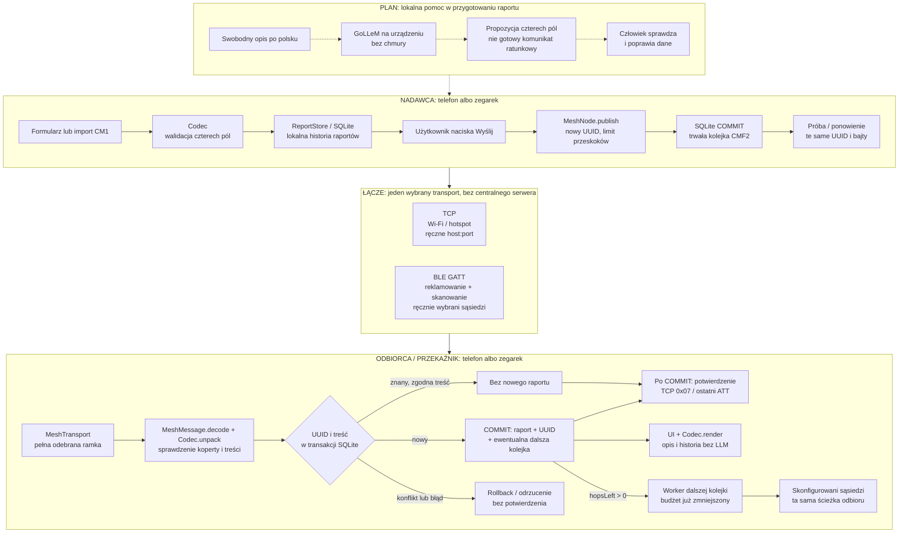

# Crisis Mesh — tablica architektury

Stan: **wersja 1.1.1 / CMF2 — trwała kolejka i potwierdzona trasa trzech fizycznych węzłów BLE**.
Ta sama aplikacja Kotlin/Compose działa na telefonie i zegarku; każde urządzenie
może być nadawcą, odbiorcą i przekaźnikiem. Komputer/ADB służyły do sterowania
podczas testów, **nie są wymaganym serwerem komunikacji**.

**Linie ciągłe: istniejąca ścieżka aplikacji. Linie przerywane: planowana
integracja lokalnego LLM, której nie ma jeszcze w aplikacji Android.**

[Wersja PNG do pobrania lub wysłania na Discord](docs/architecture.png).



## Jak czytać granice

- **LLM nie jest elementem transportu.** Ma proponować pola, nie interpretować
  odebranych pakietów, routować wiadomości ani samodzielnie alarmować.
- **Jedna transakcja odbioru:** raport, trwały UUID i kolejka dalszego
  przekazania zapisują się razem. Błąd wycofuje wszystkie te zmiany. UI tylko
  odświeża stan po COMMIT — nie decyduje o potwierdzeniu sieciowym.
- **Potwierdzenie dotyczy sąsiada, nie całej sieci.** TCP odpowiada `0x07`,
  a ostatnia odpowiedź ATT BLE następuje po COMMIT lub rozpoznaniu trwałego
  duplikatu. To nie jest dowód dostarczenia dalej ani kryptograficzny dowód zapisu.
- **Bezpieczeństwo jest osobnym brakującym elementem.** Poprawny CM1/UUID
  nie uwierzytelnia źródła. Brak szyfrowania i ochrony przed fałszywymi raportami.

## Dane przekazywane między warstwami

| Warstwa | Zawartość i granice |
|---|---|
| Raport lokalny | Cztery pola, lokalna notatka, źródło i czas urządzenia. Notatka nie jest wysyłana. |
| CM1 | `CM1\|people\|children\|hazard\|need`; stratny skrót, nie pełna treść zgłoszenia. Maks. 28 B dla tego schematu. |
| CMF2 | 4 B wersji + 16 B UUID + 1 B budżetu przekazań + CM1. Bez lokalizacji, czasu zgłoszenia, podpisu i szyfrowania. Nie współpracuje z CMF1. |
| TCP | 4-bajtowa długość big-endian + CMF2; po COMMIT odpowiedź `0x07`. Stare `0x06` nie zwalnia kolejki. |
| BLE | Ta sama długość + CMF2, potwierdzane zapisy ATT do 20 B; nowe UUID usługi/charakterystyki dla protokołu 1.1. |
| Routing | Domyślnie maks. 4 połączenia od źródła (1–8). Odbiorca z `hopsLeft = 0` zapisuje, ale nie przekazuje dalej. |
| Deduplikacja | UUID i SHA-256 treści w SQLite. Restart i usunięcie raportu nie usuwają tego znacznika. Ręczne „Wyślij” tworzy nowy UUID. |
| Kolejka | Osobne dostarczenia dla TCP/BLE i każdego sąsiada. Trwałe ponowienia używają tego samego UUID; sukces usuwa bajty ramki z kolejki i zachowuje stan potwierdzenia. |

## Gdzie jest implementacja

| Moduł | Odpowiedzialność |
|---|---|
| [MainActivity.kt](app/src/main/java/dev/crisismesh/MainActivity.kt) | Ekran Compose, formularz/import, wybór TCP/BLE, uprawnienia i kontrola kolejki. Odbiór odświeża UI już po zapisie. |
| [Codec.kt](app/src/main/java/dev/crisismesh/Codec.kt) | Walidacja, kodowanie CM1 i deterministyczny opis po polsku. |
| [ReportStore.kt](app/src/main/java/dev/crisismesh/ReportStore.kt) | SQLite `crisis.db`: raporty, skróty UUID, kolejka, sąsiedzi i konfiguracja. Jednorazowa, transakcyjna migracja z zachowanego JSON. |
| [MeshNode.kt](app/src/main/java/dev/crisismesh/MeshNode.kt) | Koperta CMF2, publikowanie i ponawianie trwałej kolejki. Przekazywanie jest planowane atomowo przez `ReportStore.accept`. |
| [MeshTransport.kt](app/src/main/java/dev/crisismesh/MeshTransport.kt) | Interfejs transportu i implementacja TCP. |
| [BleMeshTransport.kt](app/src/main/java/dev/crisismesh/BleMeshTransport.kt) | Serwer/klient GATT, reklamowanie i potwierdzane zapisy. Lokalny skan zachowuje do 8 obiektów `BluetoothDevice` z metadanymi adresów LE; nie są to stałe tożsamości. |
| [MeshFrames.kt](app/src/main/java/dev/crisismesh/MeshFrames.kt) | Fragmentacja i ograniczony bufor składania ramek BLE. |
| [backend.py](backend.py), [benchmark.py](benchmark.py) | Oddzielny eksperyment GoLLeM na komputerze, przez patchowany llama.cpp; nie backend produkcyjny aplikacji. |

## Praca offline i wznowienie

- Bez sąsiada wiadomość czeka w SQLite. Zastosowanie listy przypisuje te
  niezaadresowane wiadomości do sąsiadów.
- W żywym procesie aplikacji worker podejmuje kolejną próbę co około 20 s.
  Po force-stop lub wyłączeniu trzeba ponownie uruchomić aplikację; nie ma
  jeszcze gwarantowanej pracy w tle.
- Wybór transportu, sąsiedzi i żądanie nasłuchu są zapamiętywane. Uprawnienia
  Bluetooth nadal są konieczne; brak uprawnień nie kasuje kolejki.
- Zmienny MAC BLE wymaga ponownego skanu i **jawnego** „Ponów do obecnych
  sąsiadów”. Zachowuje to UUID, ale zmienia cele oczekujących dostarczeń.
  Nie ma jeszcze stałej tożsamości węzła ani automatycznego rozpoznawania go po zmianie MAC.
- Usunięcie lokalnego raportu anuluje jego oczekujące wysyłki, ale nie cofa
  już wysłanych kopii. Zachowany plik migracyjny JSON nie jest usuwany.


## Kontrakt planowanego lokalnego modelu

GoLLeM ma zamieniać opis w **niezatwierdzoną propozycję** JSON:

```json
{"people":5,"children":1,"hazard":"unknown","need":"water"}
```

- `people` i `children`: liczba 0–254 albo `null`; dzieci są częścią łącznej
  liczby osób. `null` nie oznacza zera.
- `hazard`: `unknown`, `fire`, `flood`, `collapse`.
- `need`: `unknown`, `rescue`, `medical`, `water`.
- Brak danych, negacja i niepewność nie mogą prowadzić do zgadywania.
  Model nie dopisuje urazów, ciężkości stanu ani diagnozy.
- Ścisły JSON nie wystarcza: potrzebna zgodność pól z opisem oraz kontrola
  człowieka przed użyciem wyniku do wysyłki.
- Inferencja ma działać lokalnie; czas, pamięć i jakość na docelowym urządzeniu
  wymagają osobnych pomiarów. Brak zadeklarowanego, zmierzonego SLA.

**Aktualnie:** eksperyment GoLLeM v6 250M Instruct v3 dał 0/10 wyników zgodnych
ze schematem. Wagi i runtime nie są dołączone do Androida. Przerywana ścieżka
na tablicy opisuje cel integracji, nie działającą funkcję.

## Co mamy potwierdzone, a czego jeszcze nie

| Obszar | Status i dowód |
|---|---|
| Telefon ↔ zegarek przez BLE, historyczne CMF1 | Sprawdzone na Galaxy A22 5G i Galaxy Watch 4, także bez Wi-Fi telefonu. [Wyniki](evidence/ble-smoke.json), [telefon](evidence/ble-phone.png), [zegarek](evidence/ble-watch-report.png). |
| TCP przez LAN / hotspot | Sprawdzone na fizycznym telefonie; szczegóły w [README](README.md#weryfikacja-na-fizycznych-urządzeniach-2026-10-19). |
| Trzy fizyczne węzły BLE i pętla | Galaxy Watch4 → A22 → A51; powrót tego samego UUID do A22 nie dopisał raportu. Koperty z budżetami 3, 2, 1 i stany kolejki odczytano z SQLite. [Wyniki i wersje](evidence/three-node-ble-smoke.json), [przekaźnik](evidence/three-node-a22-relay.png), [odbiorca](evidence/three-node-a51-final.png). |
| Trwała deduplikacja, kolejka offline, retry | Zaimplementowane. Restart nadawcy i odbiorcy, powrót sąsiada TCP/BLE oraz zmiana MAC sprawdzone na sprzęcie. [Wyniki](evidence/durable-smoke.json). |
| Praca w tle, zasięg, bateria | Brak gwarancji i testów operacyjnych. |
| Szyfrowanie i uwierzytelnianie | Brak implementacji. Tylko prototyp w zaufanym środowisku. |
| Lokalny LLM w aplikacji | Plan integracji; obecnie niezależny eksperyment Python. |
