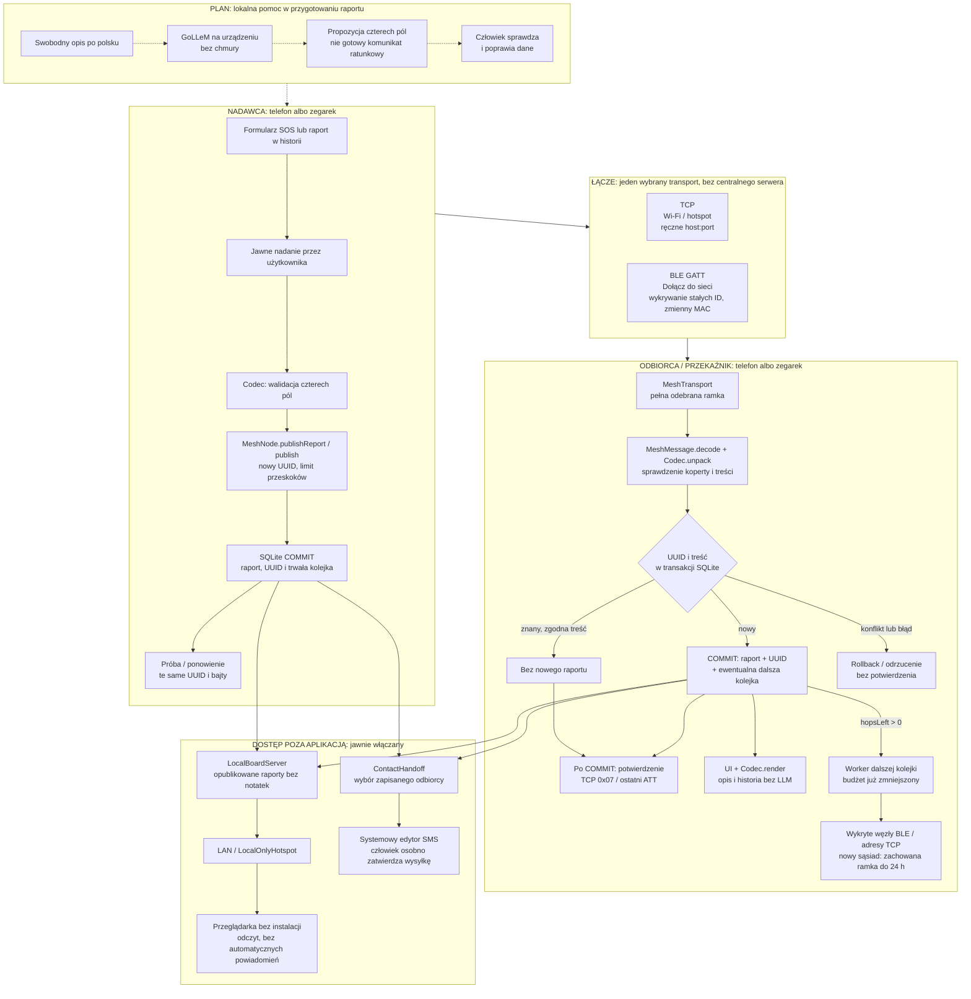

# Crisis Mesh — tablica architektury

Stan: **1.2.0 / CMF2 — automatyczna sieć BLE, publiczna tablica HTTP i jawne przekazanie do edytora SMS**. Nowe ścieżki mają dowody emulowane; wcześniejszy test fizycznych trzech węzłów dotyczy ręcznej konfiguracji 1.1.x.
Ta sama aplikacja Kotlin/Compose działa na telefonie i zegarku; każde urządzenie
może być nadawcą, odbiorcą i przekaźnikiem. Komputer/ADB służyły do sterowania
podczas testów, **nie są wymaganym serwerem komunikacji**.

**Linie ciągłe: istniejąca ścieżka aplikacji. Linie przerywane: planowana
integracja lokalnego LLM, której nie ma jeszcze w aplikacji Android.**

[Historyczny PNG architektury 1.1.1](docs/architecture.png). Aktualna architektura 1.2 jest na diagramie poniżej; PNG nie opisuje nowych modułów.



## Jak czytać granice

- **LLM nie jest elementem transportu.** Ma proponować pola, nie interpretować
  odebranych pakietów, routować wiadomości ani samodzielnie alarmować.
- **Jedna transakcja odbioru:** raport, trwały UUID i kolejka dalszego
  przekazania zapisują się razem. Błąd wycofuje wszystkie te zmiany. UI tylko
  odświeża stan po COMMIT — nie decyduje o potwierdzeniu sieciowym.
- **Potwierdzenie dotyczy sąsiada, nie całej sieci.** TCP odpowiada `0x07`,
  a ostatnia odpowiedź ATT BLE następuje po COMMIT lub rozpoznaniu trwałego
  duplikatu. Nie dowodzi dostarczenia dalej, odczytu przez człowieka ani przyjęcia pomocy.
- **Bezpieczeństwo jest osobnym brakującym elementem.** Poprawny CM1/UUID
  nie uwierzytelnia źródła. Brak szyfrowania i ochrony przed fałszywymi raportami.

## Dane przekazywane między warstwami

| Warstwa | Zawartość i granice |
|---|---|
| Raport lokalny | Cztery pola, lokalna notatka, źródło i czas urządzenia. Notatka nie jest wysyłana. |
| CM1 | `CM1\|people\|children\|hazard\|need`; stratny skrót, nie pełna treść zgłoszenia. Maks. 28 B dla tego schematu. |
| CMF2 | 4 B wersji + 16 B UUID + 1 B budżetu przekazań + CM1. Bez lokalizacji, czasu zgłoszenia, podpisu i szyfrowania. Nie współpracuje z CMF1. |
| TCP | 4-bajtowa długość big-endian + CMF2; po COMMIT odpowiedź `0x07`. Stare `0x06` nie zwalnia kolejki. |
| BLE | Ta sama długość + CMF2, potwierdzane zapisy ATT do 20 B; nowe UUID usługi/charakterystyki dla protokołu 1.1. |
| Routing | Domyślnie maks. 4 połączenia od źródła (1–8). Odbiorca z `hopsLeft = 0` zapisuje, ale nie przekazuje dalej. |
| Deduplikacja | UUID i SHA-256 treści w SQLite. Restart i usunięcie raportu nie usuwają tego znacznika. Ręczne „Wyślij” tworzy nowy UUID. |
| Kolejka | Osobne dostarczenia dla TCP/BLE i każdego sąsiada. ACK usuwa ramkę z danego dostarczenia, ale `messages.forward_frame` pozostaje do 24 h dla później spotkanych węzłów. UUID i budżet nie zmieniają się przy ponowieniu. |

## Gdzie jest implementacja

| Moduł | Odpowiedzialność |
|---|---|
| [MainActivity.kt](app/src/main/java/dev/crisismesh/MainActivity.kt) | Ekran Compose, formularz/import, wybór TCP/BLE, uprawnienia i kontrola kolejki. Odbiór odświeża UI już po zapisie. |
| [Codec.kt](app/src/main/java/dev/crisismesh/Codec.kt) | Walidacja, kodowanie CM1 i deterministyczny opis po polsku. |
| [ReportStore.kt](app/src/main/java/dev/crisismesh/ReportStore.kt) | SQLite v2: historia, UUID, retencja ramki, dostarczenia i zapisany identyfikator węzła. Migracja JSON i schematu v1 bez publikowania zakończonej starej historii. |
| [MeshNode.kt](app/src/main/java/dev/crisismesh/MeshNode.kt) | Koperta CMF2, publikowanie i ponawianie trwałej kolejki. Przekazywanie jest planowane atomowo przez `ReportStore.accept`. |
| [MeshTransport.kt](app/src/main/java/dev/crisismesh/MeshTransport.kt) | Interfejs transportu i implementacja TCP. |
| [BleMeshTransport.kt](app/src/main/java/dev/crisismesh/BleMeshTransport.kt) | GATT, reklamy z 8-bajtowym ID w odpowiedzi skanowania, skan 10 s co 40 s; do 64 endpointów, aktualność 120 s. ID wskazuje aktualny obiekt skanera, nie stanowi uwierzytelnienia. |
| [MeshFrames.kt](app/src/main/java/dev/crisismesh/MeshFrames.kt) | Fragmentacja i ograniczony bufor składania ramek BLE. |
| [LocalBoardServer.kt](app/src/main/java/dev/crisismesh/LocalBoardServer.kt) | Ograniczony serwer HTTP, publiczny odczyt raportów bez prywatnych pól; GET strony/health, odrzucenie zapisów. |
| [LocalHotspot.kt](app/src/main/java/dev/crisismesh/LocalHotspot.kt) | Rezerwacja Android LocalOnlyHotspot, dane sieci i zwalnianie zasobów; bez założenia stałego IP lub captive portalu. |
| [ContactHandoff.kt](app/src/main/java/dev/crisismesh/ContactHandoff.kt) | Do 5 lokalnych kontaktów, jawny wybór i ACTION_SENDTO; nie wysyła SMS samodzielnie i nie potwierdza odbioru. |
| [DeliveryCards.kt](app/src/main/java/dev/crisismesh/DeliveryCards.kt) | Zgoda na publiczną tablicę/hotspot, uprawnienia Wi-Fi i konfiguracja kontaktów. |
| [backend.py](backend.py), [benchmark.py](benchmark.py) | Oddzielny eksperyment GoLLeM na komputerze, przez patchowany llama.cpp; nie backend produkcyjny aplikacji. |

## Praca offline i wznowienie

- Bez sąsiada SOS czeka w SQLite. Dołączenie włącza odbiór oraz okresowe wykrywanie;
  nowy węzeł dostaje zachowaną ramkę nawet po wcześniejszym ACK innego sąsiada.
- W żywym procesie worker ponawia próby co około 20 s. Wygaśnięcie ramki kończy
  oczekujące dostarczenia, nie historię ani znaczniki deduplikacji.
- 24 h jest lokalną retencją zależną od zegara, nie globalnym czasem ważności CMF2.
  Migracja v1 nadaje ten okres odzyskanym oczekującym ramkom od czasu migracji.
- Zapisany identyfikator BLE pozostaje ten sam po zmianie MAC; skan aktualizuje
  endpoint. Limit pamięci i sąsiadów to 64. Reklamy 1.1.x nie mają nowego ID —
  wszystkie węzły automatycznej sieci trzeba zaktualizować do 1.2.
- Po force-stop potrzebne jest ponowne otwarcie aplikacji; brak gwarantowanej
  pracy w tle. Przełączenie na diagnostykę TCP zamyka BLE, nie tworzy mostu.
- Usunięcie lokalnego raportu anuluje jego oczekujące wysyłki, ale nie cofa
  już wysłanych kopii. Zachowany plik migracyjny JSON nie jest usuwany.


## Kontrakt planowanego lokalnego modelu

GoLLeM ma zamieniać opis w **niezatwierdzoną propozycję** JSON:

```json
{"people":5,"children":1,"hazard":"unknown","need":"water"}
```

- `people` i `children`: liczba 0–254 albo `null`; dzieci są częścią łącznej
  liczby osób. `null` nie oznacza zera.
- `hazard`: `unknown`, `fire`, `flood`, `collapse`.
- `need`: `unknown`, `rescue`, `medical`, `water`.
- Brak danych, negacja i niepewność nie mogą prowadzić do zgadywania.
  Model nie dopisuje urazów, ciężkości stanu ani diagnozy.
- Ścisły JSON nie wystarcza: potrzebna zgodność pól z opisem oraz kontrola
  człowieka przed użyciem wyniku do wysyłki.
- Inferencja ma działać lokalnie; czas, pamięć i jakość na docelowym urządzeniu
  wymagają osobnych pomiarów. Brak zadeklarowanego, zmierzonego SLA.

**Aktualnie:** eksperyment GoLLeM v6 250M Instruct v3 dał 0/10 wyników zgodnych
ze schematem. Wagi i runtime nie są dołączone do Androida. Przerywana ścieżka
na tablicy opisuje cel integracji, nie działającą funkcję.

## Co mamy potwierdzone, a czego jeszcze nie

| Obszar | Status i dowód |
|---|---|
| Telefon ↔ zegarek przez BLE, historyczne CMF1 | Sprawdzone na Galaxy A22 5G i Galaxy Watch 4, także bez Wi-Fi telefonu. [Wyniki](evidence/ble-smoke.json), [telefon](evidence/ble-phone.png), [zegarek](evidence/ble-watch-report.png). |
| TCP przez LAN / hotspot | Sprawdzone na fizycznym telefonie; szczegóły w [README](README.md#weryfikacja-na-fizycznych-urządzeniach-2026-10-19). |
| Trzy fizyczne węzły BLE i pętla — historyczne 1.1.x | Ręczna trasa Galaxy Watch4 → A22 → A51 i powrót bez duplikatu. [Wyniki i wersje](evidence/three-node-ble-smoke.json), [przekaźnik](evidence/three-node-a22-relay.png), [odbiorca](evidence/three-node-a51-final.png). |
| Automatyczna sieć 1.2, późny sąsiad i pętle | Trzy emulatory Android/Wear, ten sam UUID, trzeci dołącza po wcześniejszym ACK. Nie jest to próba fizycznego zasięgu. [Wyniki](evidence/auto-mesh-smoke.json). |
| Tablica bez aplikacji i SMS | Rzeczywista przeglądarka odczytała HTTP z Androida przez przekierowanie ADB; prywatna notatka nieobecna. Systemowy edytor SMS dostał dane, bez zatwierdzania wysyłki. [Tablica](evidence/auto-mesh-board.png), [SMS](evidence/auto-mesh-sms-preview.png). Fizyczne połączenie klienta z nowym hotspotem pozostaje niesprawdzone. |
| Migracje, późny sąsiad, retencja, deduplikacja | 18 testów Android w emulatorze, w tym migracja v1 i atomowe SOS; wcześniejsze testy fizyczne 1.1: [wyniki](evidence/durable-smoke.json). |
| Praca w tle, zasięg, bateria | Brak gwarancji i testów operacyjnych. |
| Szyfrowanie i uwierzytelnianie | Brak implementacji. Tylko prototyp w zaufanym środowisku. |
| Lokalny LLM w aplikacji | Plan integracji; obecnie niezależny eksperyment Python. |
